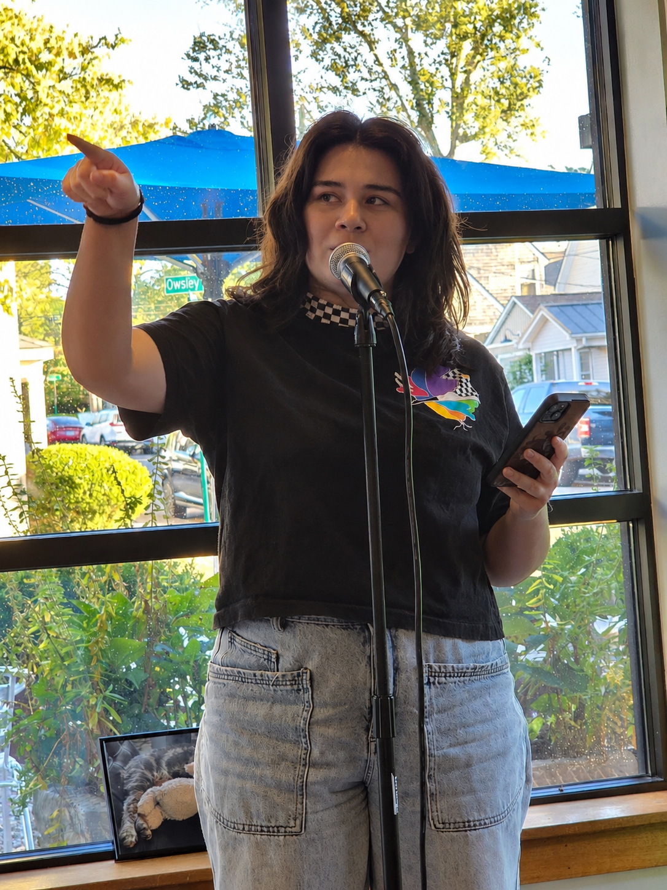
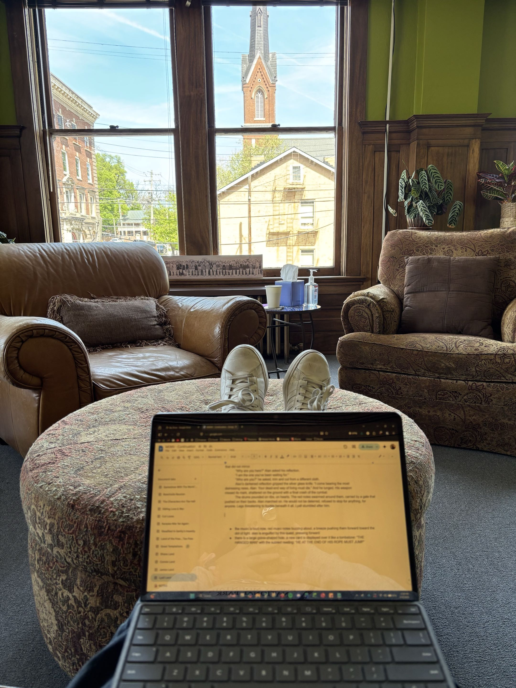
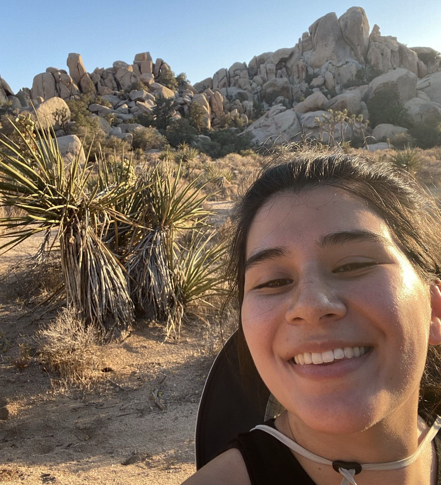

:::: {.columns}

::: {.column width="62%"}
# So you stumbled upon my website...

I suppose, then, I can indulge you with a story or two.

The 21st century is a period defined by globalization, acceleration, and fragmentation. In many ways, so am I. I’m the daughter of an immigrant, raised less in one physical place I could call home than in the strange, borderless digital world my generation inherited. Long before I did anything literary in person, I was writing online with strangers scattered across the internet, building little worlds with people I would never meet.

I began my career as an engineer. I published research on hydrogen fuel cells, modeled the movement of nuclear drums, and managed data infrastructure for electric utilities. Eventually, I left corporate life for a path far less certain but far more meaningful to me: one centered on writing, community, and the complicated business of being alive.

Now, in Lexington, Kentucky, I’ve immersed myself in the literary and civic life around me. I’m rather fond of living between the analytical and the creative, bringing the systems-minded curiosity that once drew me to engineering into poetry, fiction, organizing, volunteering, and community building.

I’m currently working on a few secret pieces. The least secret of them is one I share rather openly at open mics: *Suffering Is Good for Business*, a poetry collection that uses humor, satire, and skit-like pieces to examine a culture of consumption, distraction, superficiality, performance, and apathy.

These days, you can usually find me performing radical poetry at open mics, reading old books, volunteering at the library bookstore, salsa dancing until sunrise, gathering writers around mildly revolutionary ideas, or otherwise indulging my fondness for the whimsical, eccentric, and unapologetically sincere.

So, yes, you stumbled upon my little lair of oddities and curiosities. It isn’t especially polished, and it’s probably stranger and more amusing than professional, but hey, at least now you know a human lives here rather than an artificially intelligent robot.

Reach out if you’d like. I’m always happy to converse about art, literature, technology, politics, culture, community, or whatever other peculiar humanistic nuance comes to mind.
:::

::: {.column width="5%"}
:::

::: {.column width="33%"}

:::

::::