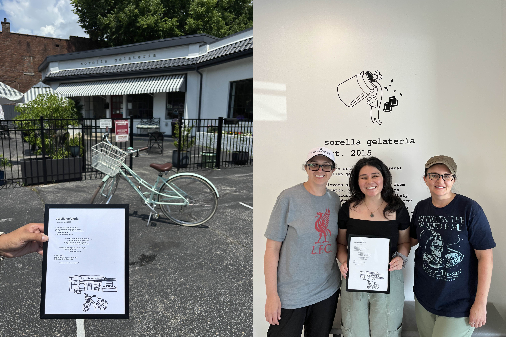
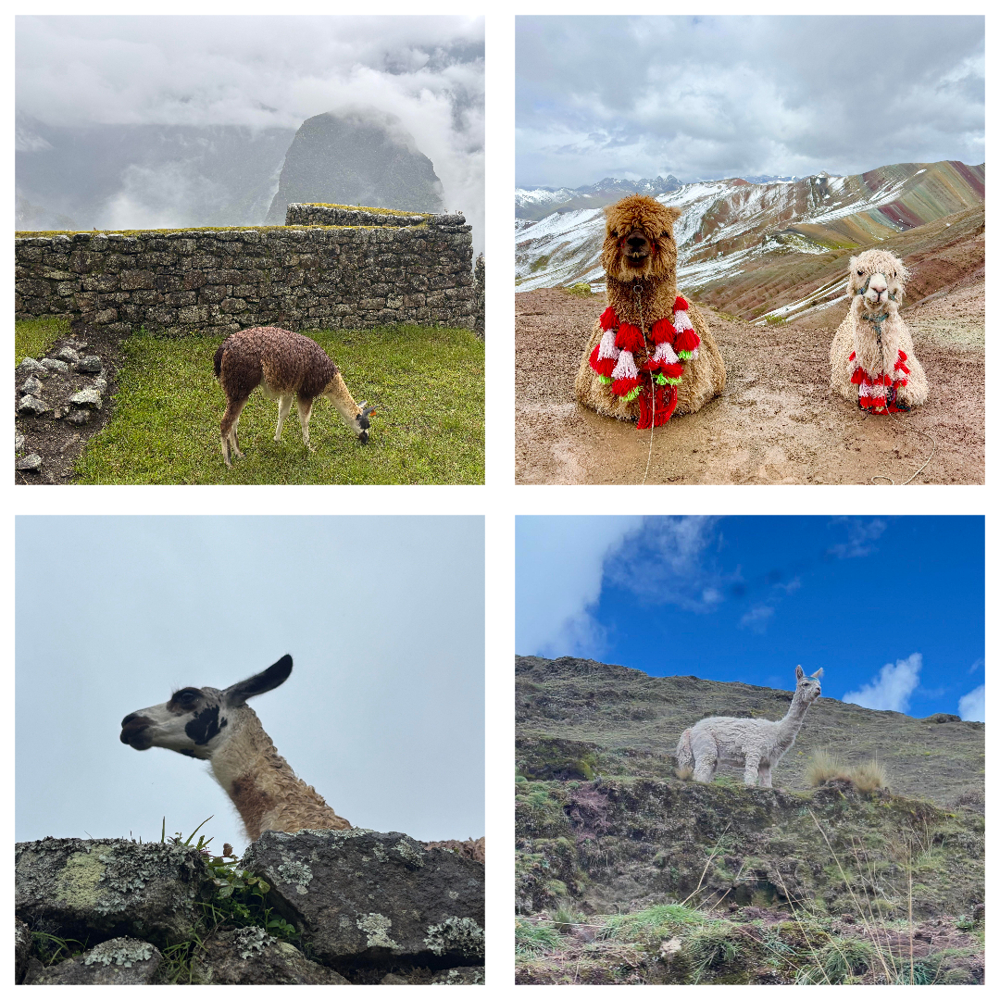
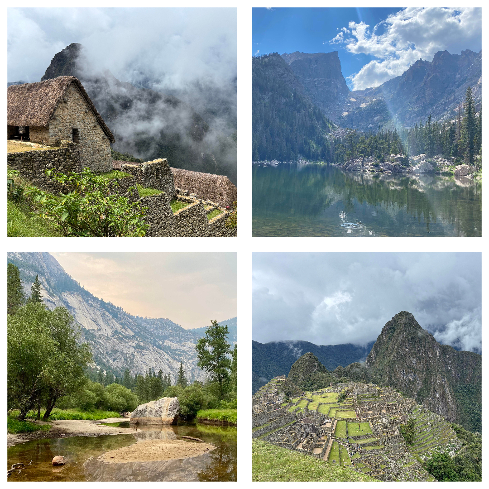
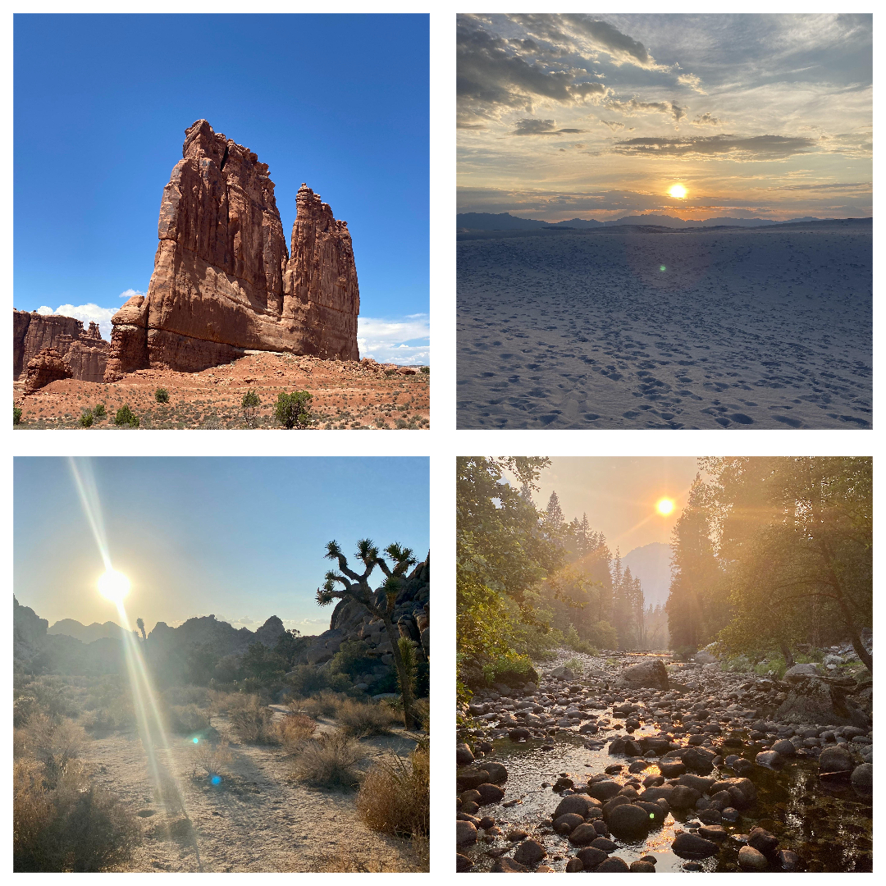
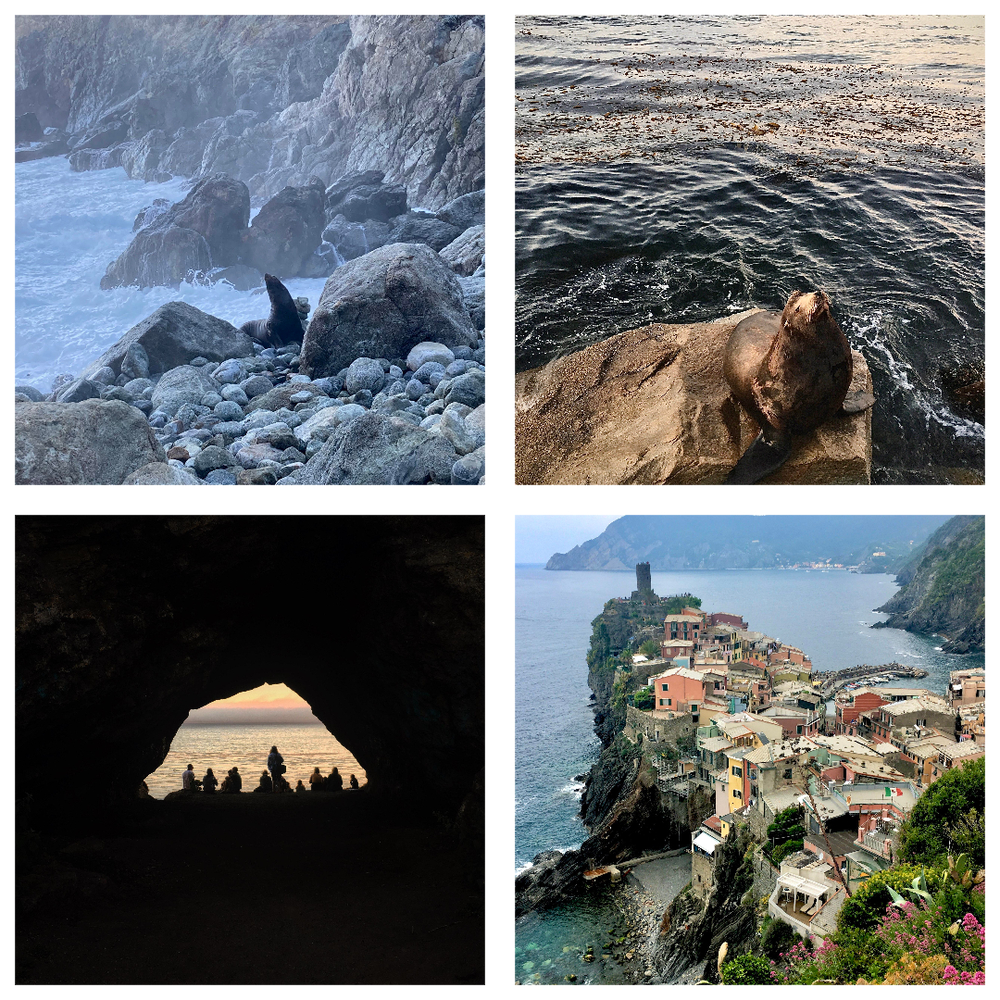
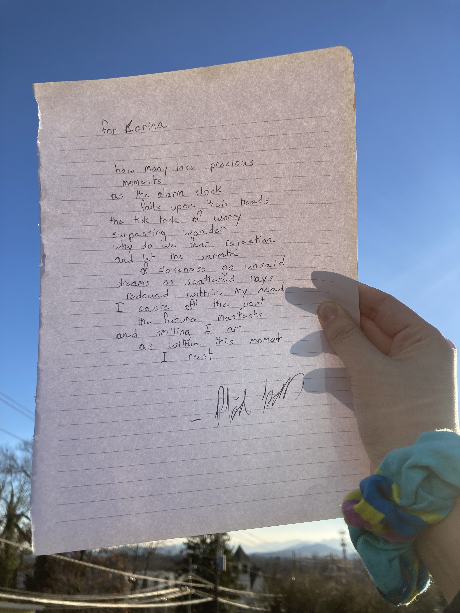
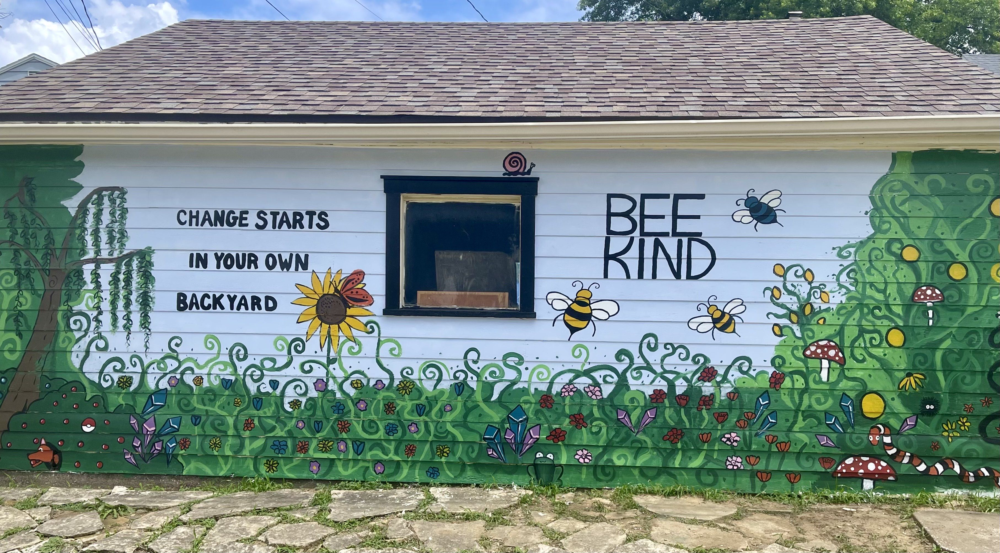

Below are selections from my artistic portfolio, spanning fiction, poetry, spoken word, dance, photography, songwriting, music performance, and visual art. My strongest work is in fiction and poetry, though much of it is currently reserved for future publication, so only a small selection appears here.

## Fiction

**The Serpent's Utopia**, published in a local anthology on the theme of crossroads, is a spoken-word short story inspired by Genesis that explores how growth emerges only when we embrace discomfort and risk.

This piece was written to be heard. Press play to listen to the recorded performance. <audio controls style="width:100%;"> <source src="portfolio_files/fiction_spoken_word_the_serpents_utopia.mp3" type="audio/mpeg"> Your browser does not support the audio element. </audio> <iframe src="portfolio_files/fiction_the_serpents_utopia.pdf" width="100%" height="400px"></iframe>

## Poetry

Most of my poetry examines the contradictions of contemporary life, especially technology, consumption, loneliness, freedom, and connection, often through humor or the experimentation with form. I am currently working on a poetry manuscript titled *Suffering Is Good for Business*, which uses humor, satire, and cultural critique to examine a culture of consumption, distraction, superficiality, and apathy that pervades contemporary life.

**Are we all ADHD?** <iframe src="portfolio_files/poem_are_we_all_adhd.pdf" width="100%" height="350px"></iframe>

**A Broken Freedom** <iframe src="portfolio_files/poem_a_broken_freedom.pdf" width="100%" height="350px"></iframe>

**The Violinist's  Ballad** (published by Yearling) <iframe src="portfolio_files/poem_the_violinists_ballad.pdf" width="100%" height="350px"></iframe>

**Sorella Gelateria** (gifted & displayed) <iframe src="portfolio_files/poem_sorella_gelateria.pdf" width="100%" height="350px"></iframe>

Click for more details:

What an incredible joy it is to gift poem & art to my favorite small business. I adore the summers filled with bike rides to the local gelateria run by two sisters. The love and tears received warmed my heart.

{width="100%" fig-align="center"}

## Spoken Word

Here are two glimpses into my spoken word work. On the left is a poem I performed to open an EDM festival set; on the right is my first open mic piece, a humorous poem about targeted advertising. These days, I gravitate toward cultural, socioeconomic, and political subjects, often between making people laugh and making the room go quiet.

::: video-pair
<video
  controls
  playsinline
  preload="none"
  poster="portfolio_files/spoken_word_solstice_preview.png"
>
  <source
    src="portfolio_files/spoken_word_solstice.mp4"
    type="video/mp4"
  />
  Your browser does not support the video tag.
</video>

<video controls playsinline>

<source src="portfolio_files/spoken_word_targeted_advertisement.mp4" type="video/mp4" />

Your browser does not support the video tag.

</video>
:::

## Dance

My partner and I won third place in a salsa competition with our first performance and original choreography. I usually dance socially and improvise, but I loved exploring the story and emotion of this piece.W e now teach nonprofit salsa and bachata dance lessons, with proceeds supporting mutual aid through our local arts collective.

<video controls width="80%">

<source src="portfolio_files/dance_salsa_choreo.mp4" type="video/mp4">

Your browser does not support the video tag.

</video>

::: video-pair
<video controls playsinline>

<source src="portfolio_files/dance_bachata_lesson_1.mp4" type="video/mp4" />

Your browser does not support the video tag.

</video>

<video controls playsinline>

<source src="portfolio_files/dance_bachata_lesson_2.mp4" type="video/mp4" />

Your browser does not support the video tag.

</video>
:::

## Photography

{width="100%" fig-align="center"} {width="100%" fig-align="center"} {width="100%" fig-align="center"} {width="100%" fig-align="center"}

## Songwriting

All songs were created in 2022 to explore lyric and melody. 

::: video-pair
<video controls playsinline>

<source src="portfolio_files/song_i_want_to_live.mp4" type="video/mp4" />

Your browser does not support the video tag.

</video>

<video controls playsinline>

<source src="portfolio_files/song_the_life_we_live.mp4" type="video/mp4" />

Your browser does not support the video tag.

</video>
:::

Click for more details:

This song began at a Poetry On Demand stand in Asheville, NC. I shared a few words, and the poet wove them into a poem. I loved it so much that I made it into a song. The original poem is included below. 

::: video-pair
<video controls playsinline>

<source src="portfolio_files/song_for_you_my_dear.mp4" type="video/mp4" />

Your browser does not support the video tag.

</video>

<video controls playsinline>

<source src="portfolio_files/song_with_you.mp4" type="video/mp4" />

Your browser does not support the video tag.

</video>
:::

Click for more details:

This song came from a playful challenge: For the left song, I asked a friend for random words to make them into lyrics. The chosen words were:

-   Pomegranates
-   Blue bonnets
-   Sweater vest
-   Sunset
-   Georgia
-   Wagon wheel

For the right song, my partner picked:

-   Cotton candy
-   Twix
-   Penguin
-   New York City
-   Ice skating

## Violin

Although I no longer play, violin was once a deep passion of mine. Below are videos from when I was 17/18.

**Violin Looper Performance** of "Secrets" by OneRepublic, in the style of Bryson Andres <video controls width="80%"> <source src="portfolio_files/violin_looper_secrets.mp4" type="video/mp4"> Your browser does not support the video tag. </video>

**Chamber Orchestra Performance** of my arrangement to Lana Del Rey's "Young And Beautiful" <video controls width="80%"> <source src="portfolio_files/violin_young_and_beautiful.mp4" type="video/mp4"> Your browser does not support the video tag. </video>

**Violin & Cello Duet Practice** (unfortunately, I no longer have the composer's name) <audio controls style="width:80%;"> <source src="portfolio_files/violin_duet.mp3" type="audio/mpeg"> Your browser does not support the audio element. </audio>

## Visual Art

This garage mural was a collaborative project between my friend and her husband, my sister, and me. It has since become a neighborhood landmark, bringing smiles to those who pass by.

{width="100%" fig-align="center"}
